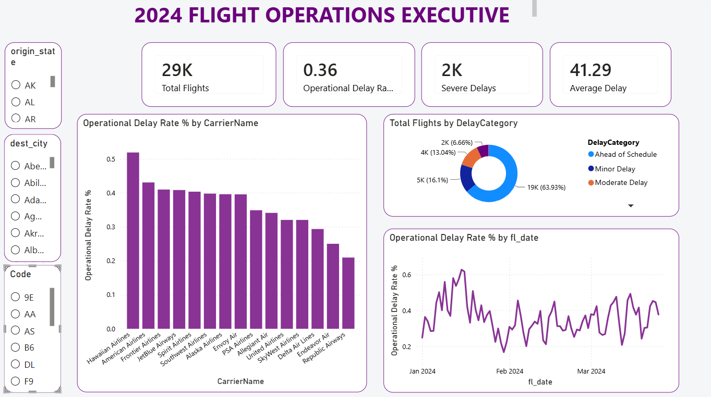

# US Flight Operations Q1 2024: Power BI Dashboard

**Which US airlines, causes and periods drive flight delays and cancellations?**

A three-page Power BI report built on 30,000 US domestic flights from January to March 2024. It follows one story across the pages: **what happened** (headline performance), **why it happened** (delay causes) and **where and who** (airports, routes and airlines).



## Key findings

1. **Late-arriving aircraft are the biggest cause of delay.** They account for 39% of all delay minutes attributed to a cause (159,749 of 406,557), ahead of carrier problems (33%), the national airspace system (20%) and weather (7%). This is a knock-on effect: one late flight delays every later flight on the same aircraft.
2. **Scale does not explain reliability.** Delta and American fly almost the same number of flights (4,108 and 4,255), but 43% of American's flights arrive late against 29% of Delta's. The gap holds on the stricter 15-minute standard: 25.5% against 14.1%.
3. **About a third of cancellations are within the airlines' control.** Of 538 cancellations, 326 (61%) were caused by weather, 187 (35%) by the carrier and 25 (5%) by the national airspace system.
4. **Arrival delay rates vary widely by airline**, from 21% (Republic Airways) to 52% (Hawaiian Airlines).

### Recommendations

- **Add buffer time to aircraft rotations,** especially the first departure of the day at busy hubs, to stop delays cascading through the schedule.
- **Benchmark American Airlines against Delta** on turnaround, crew scheduling and maintenance planning, and track the gap each quarter with the Carrier Delay Rank measure.
- **Target carrier-caused cancellations,** the only controllable group: halving them would prevent about 93 cancellations a quarter.

## The data

| | |
|---|---|
| **Source** | [US Bureau of Transportation Statistics](https://www.transtats.bts.gov), Airline On-Time Performance data |
| **Sample** | 30,000 flights, stratified by month (`Data/flight_data_2024.csv`) |
| **Period** | 1 January – 25 March 2024 |
| **Coverage** | 15 airlines, 326 origin and 324 destination airports, 35 columns |

The raw data needed real cleaning: times stored as HHMM integers (1640 = 16:40), dates as text, cause codes instead of names, and blank delay values for cancelled flights.

### Delay definitions

"Delayed" can mean different things, so the report uses these definitions:

| Measure | Definition | Value |
|---|---|---|
| Delayed Flights / Delay Rate (DAX) | Departure delay over 15 minutes, excluding cancellations | 5,724 flights (19.1%) |
| Operational Delay Rate (dashboard visuals) | Share of flights arriving late by any amount | 10,549 of 29,388 flights (36%) |
| Average Delay (dashboard visuals) | Average arrival delay of late-arriving flights | 41.3 minutes |
| Total Delay Minutes (dashboard cards) | Sum of positive arrival delays | 435,609 minutes |
| Delay minutes by cause | Sum of the five cause columns | 406,557 minutes |

## How it was built

### 1. Cleaning in Power Query

| Step | What it does |
|---|---|
| Fix data types | Dates to Date, numbers to whole or decimal, so relationships and time intelligence work |
| Parse HHMM times | Splits times like 1640 into hour and minute, giving a departure-hour column |
| Flight status and delay category | One column for each flight's outcome (cancelled, diverted, delayed, on time) and one for delay size (early/on time, minor, moderate, severe) |
| Cancellation reason | Replaces codes A, B and C with Carrier, Weather and National Air System |
| Airline names | Merges in full names, so charts show "Southwest Airlines" instead of "WN" |
| Route column | Combines origin and destination, e.g. "DFW → AMA" |
| Remove blanks and errors | Keeps counts and averages accurate |
| Dimension tables | Builds airline, origin airport and destination airport tables for the star schema |

### 2. Data model

A **star schema** with the flights table at the centre and four dimension tables: Date, Airline, Origin Airport and Destination Airport. All relationships are one-to-many with single-direction filtering. Origin and destination airports are separate tables, so filtering one never accidentally filters the other.


### 3. DAX measures

15 measures across three levels. The most important:

```dax
Delay Rate = DIVIDE([Delayed Flights], [Total Flights], 0)

Total Delay Minutes =
SUMX(
    flight_data_2024,
    flight_data_2024[carrier_delay] + flight_data_2024[weather_delay] +
    flight_data_2024[nas_delay] + flight_data_2024[security_delay] +
    flight_data_2024[late_aircraft_delay]
)

Carrier Delay Rank =
RANKX(ALL(flight_data_2024[op_unique_carrier]), [Delay Rate], , DESC, Dense)

Delay Rate vs Overall =
VAR CarrierRate = [Delay Rate]
VAR OverallRate = CALCULATE([Delay Rate], ALL(flight_data_2024))
RETURN CarrierRate - OverallRate
```

| Level | Measures |
|---|---|
| Core KPIs | Total Flights, Delayed Flights, On-Time Flights, Delay Rate, Cancelled Flights, Cancellation Rate |
| Business measures | Diverted Flights, Diversion Rate, Average Departure Delay, Average Arrival Delay, Average Flight Distance, Total Delay Minutes |
| Advanced | Carrier Delay Rank (RANKX), Delay Performance (VAR + CALCULATE/ALL + IF), Delay Rate vs Overall |

Screenshots of every transformation and measure are in [`Screenshots/`](Screenshots/).

## The report

**Page 1: Executive overview** (shown at the top). KPI cards, late-arrival rate by airline, flights by delay category, and the daily trend, which peaks above 60% on 15–16 January.

**Page 2: Delay diagnostics.** Delay minutes by cause, how each cause changes by month, and average delay by airline.


**Page 3: Airport and route analysis.** Delay minutes by airline, a map of flight volume and delays by state, and an airline comparison table.


## Open it

Download [`Power_BI/Power BI.pbix`](Power_BI/) and open it in Power BI Desktop (free, Windows). A PDF version of the report is in [`Flight_BI_Report.pdf`](Flight_BI_Report.pdf).

## Repository structure

```
├── Data/flight_data_2024.csv   # 30,000-flight sample from BTS
├── Power_BI/Power BI.pbix      # The report
├── Flight_BI_Report.pdf        # PDF export
├── Screenshots/                # Report pages, transformations, DAX measures
└── README.md
```

## Author

**Betelhem Getachew Kebede**, Data Science & Analytics, USIU-Africa. Built for DSA 3050 (Business Intelligence & Data Visualization).
